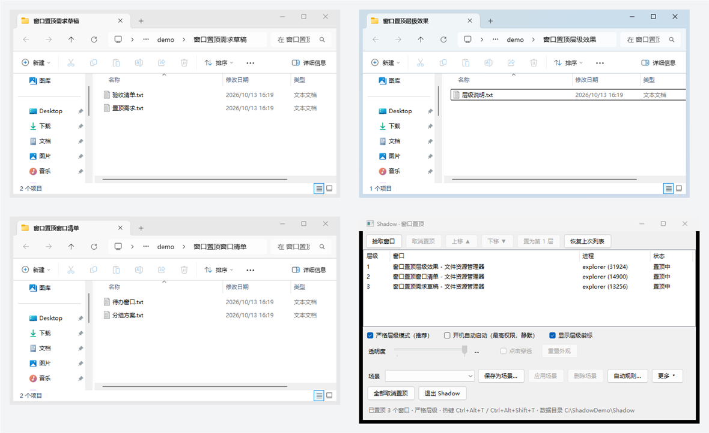
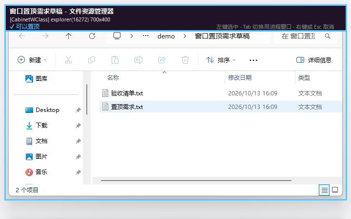
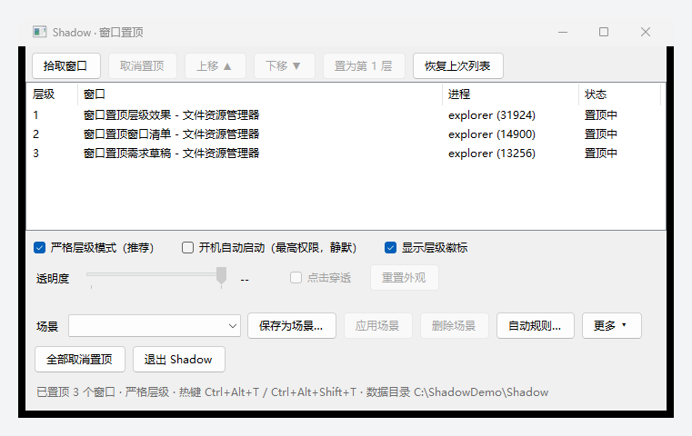

# Shadow · Windows 窗口置顶与层级管理

把「让这个窗口永远在最上面」做成一件可控的事：可点选、可拖拽排序、可热键指定层号、可半透明与点击穿透、可存成场景，并在退出时把所有窗口还原干净。

> 仓库 <https://github.com/amigo248/shadow-window-pin> · MIT 许可 · 当前版本 1.0.0 · 免安装，解压即用（见下方《下载与安装》）



> 上图：三个资源管理器窗口分别被设为第 1 / 2 / 3 层（左上角圆形徽标就是层号，青色为第 1 层），右下角是主面板。

---

## 下载与安装

到 [Releases](https://github.com/amigo248/shadow-window-pin/releases/latest) 页面下载最新的压缩包。三种包内容一样（都含主程序 `Shadow.exe` 和命令行 `ShadowCli.exe`），区别只在体积与依赖：

| 压缩包 | 体积 | 需要预装 | 适合谁 |
| --- | --- | --- | --- |
| `Shadow-1.0.0-win-x64-selfcontained.zip` | 约 61 MB | 什么都不用装 | **推荐**，解压就能跑 |
| `Shadow-1.0.0-win-x64-singlefile.zip` | 约 63 MB | 什么都不用装 | 想只保留两个 exe 的便携用法（首次运行需要可写的 `%TEMP%`） |
| `Shadow-1.0.0-win-x64-net8.zip` | 约 0.3 MB | .NET 8 桌面运行时 | 本机已经装了 .NET 8 桌面运行时 |

以自包含版为例：

1. 下载 zip，右键「全部解压缩」（**不要直接在压缩包里双击运行**）。
2. 把解压出来的文件夹放到喜欢的位置，例如 `D:\Tools\Shadow\`。
3. 双击 `Shadow.exe`，在弹出的 UAC 提示里点「是」。
   - 为什么必须要管理员权限：Windows 只允许**拥有前台权限**的进程去重排窗口 Z 序，而 Shadow 要在后台维持层级、切场景、还原置顶；不提升权限会出现「一堆窗口置顶失败」。
4. 主面板出来后即可使用：点「拾取窗口」，或按 `Ctrl+Alt+T` 钉住鼠标下的窗口。托盘图标常驻，点面板的叉只是收起面板。
5. 想开机自启：勾选面板上的「开机自动启动（最高权限，静默）」。它走任务计划程序，登录时静默启动，不会再弹 UAC。

> **SmartScreen / 杀软**：这是没有代码签名的开源小工具，首次运行可能弹「Windows 已保护你的电脑」→ 点「更多信息」→「仍要运行」；个别杀软会对「注册全局热键 + 操作其它窗口」这类行为报可疑，需要的话把解压目录加进白名单。详见《关于杀软误报》。

系统要求：Windows 10 1809（10.0.17763）或更高，x64。自包含版不需要任何额外运行时。

---

## 功能

### 核心（P0）

- **单窗口 / 多窗口置顶**：托盘热键钉住鼠标下的窗口，或用主面板「拾取窗口」的准星选择。
- **自定义层级**：主面板里拖拽排序、上移 / 下移、「置为第 1 层」，或直接按 `Ctrl+Alt+1…9` 把鼠标下的窗口设成第 N 层。
- **严格层级模式**（默认开启）：勾选时，无论前台程序怎么抢，Shadow 都会按你定的层级把窗口重新压回去；取消勾选则是宽松模式 —— 允许点击把已置顶窗口提到最前，顺序交给 Windows。
- **层级徽标**：每个置顶窗口左上角浮出层号（第 1 层青色，其余灰色）。徽标点击穿透、不进 Alt-Tab、不抢焦点，可在面板关闭。
- **准星拾取器**：左键选中、`Tab` 切换同一进程的其它窗口、右键或 `Esc` 取消。不能置顶的窗口框会变红，有风险提示的变橙（独占全屏、反作弊进程、DirectComposition 等）。



### 增强（P1）

- **透明度 10%–100%** 与 **点击穿透**：面板里选中窗口后调整，或由 CLI / 规则设置。调整**成功不弹系统提示**（面板上的数值、列表里的「外观」列就是结果，提示弹多了反而吵）；只有两种情况会提醒一次 —— 设置失败（含具体原因），以及**打开点击穿透**时（那是唯一可能把你关在门外的操作，提示里会说明如何取消）。
- **场景**：把当前这一批窗口（层级 + 外观 + 位置尺寸）存成场景，一键切换。
- **自动规则**：按进程名或窗口标题的正则匹配，窗口一出现就自动置顶并套用外观；排除规则优先于置顶规则；自动置顶有 12 个窗口的上限兜底（防止一条写得太宽的正则把整屏钉住）。
- **几何记忆**：恢复上次列表 / 切换场景时，连窗口的位置与尺寸一起还原。
- **命令行接口**：`ShadowCli.exe` 通过命名管道驱动 GUI，方便脚本化。
- **崩溃残留自动修复**：非正常退出（崩溃 / 强杀）后，下次启动先摘掉上次遗留的置顶状态，再按记录把它恢复回来。
- **开机自启**：走任务计划程序（`ONLOGON` + `/RL HIGHEST`），登录时静默提权启动，不弹 UAC。

---

## 主面板与托盘



- **托盘菜单**：打开主面板 / 钉住（取消）鼠标下的窗口 / 取消全部置顶 / 关于 Shadow / 退出（还原全部置顶）。双击托盘图标打开主面板。
- **关闭面板 ≠ 退出**：点叉只收起面板，Shadow 继续托盘常驻；真正退出请用面板的「退出 Shadow」或托盘菜单的「退出（还原全部置顶）」。
- **「更多 ▾」**：自定义全局热键、启用 / 关闭命令行接口（命名管道）、导出配置、导入配置、打开数据目录。
- **面板底部状态栏**：当前置顶数量、严格 / 宽松模式、**实际生效的**热键组合、数据目录。
- **打开面板时会临时置顶**：否则你钉住的窗口永远压着面板，点什么都点不到。面板重新拿到焦点、或几秒后你已经在操作别的东西，它就会自己还原成普通窗口；面板弹出的对话框（比如「自动规则」）也会跟着临时置顶，不会被面板自己盖住。
- **启动时只抬到最前，不给面板加置顶属性**：双击启动那次只把面板一次性抬到普通层带最前面并激活它，面板本身**不是**置顶窗口（`WS_EX_TOPMOST` 不设），所以它不会一直浮在你所有窗口之上；之后想让被置顶窗口压住的面板重新露出来，用托盘双击或 `shadowcli panel`（那条路径才会临时置顶）。
- **双击启动 = 打开面板**：你自己双击 `Shadow.exe`（不带参数）时，主面板会直接摆出来，不会只留一个托盘图标让你猜。如果 Shadow 已经在运行，再双击一次会**请已运行的实例把面板打开**（不再弹「已经在运行」的框）—— 外部进程抬不动被置顶窗口压住的面板，只有界面自己动手才有效。
- **开机自启是安静的**：自启任务用 `--autostart` 启动，只把图标放进托盘，不弹面板（无人值守时弹窗会打扰你）。
- **面板宽度**：最小宽度按最下面那排控件（场景行最右边的「更多 ▾」）自动算出来，不会出现按钮被右边缘裁掉的情况；你拖动改过的尺寸会记住。

---

## 全局热键

| 功能 | 默认组合 | 被占用时依次回退到 |
| --- | --- | --- |
| 钉住 / 取消鼠标下的窗口 | `Ctrl+Alt+T` | `Ctrl+Alt+P` → `Ctrl+Alt+W` → `Ctrl+Alt+F9` |
| 取消全部置顶 | `Ctrl+Alt+Shift+T` | `Ctrl+Alt+Shift+P` → `Ctrl+Alt+Shift+F9` |
| 把鼠标下的窗口设为第 N 层（N = 1…9） | `Ctrl+Alt+1…9` | `Ctrl+Shift+1…9` |

全局热键是「先到先得」的共享资源：被截图工具、输入法、聊天软件占走后注册会失败（`ERROR_HOTKEY_ALREADY_REGISTERED`）。所以 Shadow 会按候选表依次尝试，**并把实际生效的组合显示在面板状态栏和托盘菜单上**，不会出现「写了 Ctrl+Alt+T 但按了没反应」。也可以在「更多 ▾ → 自定义全局热键…」里指定组合，被占用时同样退回候选表。

---

## 命令行接口（ShadowCli）

```
Shadow 命令行接口（用法：ShadowCli <命令> [参数]）

命令：
  status                              查看 Shadow 是否在运行、置顶了几个窗口
  list                                按层级列出当前置顶的窗口
  pin     --title <正则> [--rank N]   置顶匹配的窗口；--rank 指定层级（1 = 最上层）
  pin     --process <正则>            按进程名匹配（也可给 --handle 0x1234 精确指定）
  unpin   --all                       取消全部置顶
  unpin   --title <正则>              取消匹配窗口的置顶
  toggle                              置顶 / 取消当前前台窗口
  scene                               列出所有场景
  scene   <名称>                      切换到场景
  scene   save <名称>                 把当前置顶列表保存成场景
  appearance --title <正则> --opacity <10-100> [--click-through]
                                      改透明度 / 点击穿透（窗口必须已在置顶列表里）
  appearance --opacity <10-100>       不给选择器 / 给 --all 时改全部置顶窗口
  restore                             按上次的清单恢复置顶（等价于主面板同名按钮）
  panel                               打开主面板（等价于双击托盘图标）
  exit                                让 Shadow 正常退出（会先把所有窗口还原）

通用参数：
  --title / --process 是 .NET 正则，不区分大小写，分别匹配窗口标题与进程名
  --handle 0x1234     直接指定窗口句柄（优先于正则）
  --json              输出原始 JSON（给脚本用）
```

示例：

```powershell
ShadowCli status
ShadowCli pin --process notepad --rank 1
ShadowCli pin --title "^Visual Studio Code$" --opacity 85
ShadowCli appearance --opacity 60 --click-through      # 改全部置顶窗口
ShadowCli scene save 写代码
ShadowCli scene 写代码
ShadowCli exit
```

要点：

- CLI 自己**不提权**（`asInvoker`），它通过命名管道 `Shadow.Command.v1` 与已经以管理员身份运行的 GUI 通信，所以脚本调用不会弹 UAC。
- 只有在 GUI 运行、且面板「更多 ▾」里没关掉命令行接口时才能连上；连不上时 CLI 会明确告诉你是「没在运行」还是「接口被关掉了」。
- 输出表格按中日韩字符宽度对齐；置顶没真正生效的窗口会在句柄后标 `（未生效）` —— 这也是排查「为什么这个窗口钉不住」的入口。

---

## 数据与配置

| 内容 | 位置 |
| --- | --- |
| 配置 | `%APPDATA%\Shadow\config.json` |
| 运行日志 | `%APPDATA%\Shadow\shadow.log` |
| 自检报告 | `%APPDATA%\Shadow\selftest.log` |
| 运行标记 | `%APPDATA%\Shadow\running.marker`（用它判断上次是否正常退出） |

- **便携模式**：`%APPDATA%` 取不到或不可写时（例如放在无写权限的目录里运行），自动改用 `exe 同级目录\Shadow\`，面板状态栏会显示实际使用的数据目录。
- **写盘方式**：`config.json` 先写临时文件再原子替换，断电 / 崩溃不会留下半个 JSON；配置损坏时自动备份成 `config.corrupt.json` 并退回默认值。
- **配置内容**：层级列表、场景、规则、严格模式、面板尺寸、徽标开关、热键覆盖、自启状态、CLI 开关。

---

## 已知限制

1. **独占全屏的游戏无法置顶。** 这类程序绕过 DWM 直接切换显示器模式，`WS_EX_TOPMOST` 在物理上失效。Shadow 会检测到（对比当前显示模式与系统设置的分辨率）并在拾取器 / 提示里说明，而不是假装成功。
2. **置顶「别人的窗口」需要对方给前台权限。** 按微软文档，`SetWindowPos` 要把窗口提到最前，目标窗口所属进程必须拥有 `SetForegroundWindow` 权限；后台窗口可能被系统直接拒绝（调用返回成功但位不生效）。**你主动**置顶 / 调整层级时，Shadow 遇到回读失败会尝试把目标窗口先切到前台再置顶一次 —— 这**可能把焦点切到那个窗口**，并且如果系统仍然拒绝，会明确提示「请先点一下该窗口再重试」。后台自动维护**不会**抢焦点（切焦点本身就会让画面闪）。
3. **严格层级模式下，上层窗口会挡住下层窗口的点击。** 这是置顶语义的必然结果（`Ctrl+Alt+2…9` 给下层窗口降级，或改用宽松模式 + 点击穿透）。
4. **有些应用会自己抢 Z 序或主动忽略置顶请求。** 实测 Windows 11 的新版记事本就会出现「系统返回成功但置顶位不生效」；DirectComposition / UWP 窗口也可能在切页、进全屏时自己改回。徽标会被 Z 序变化顶掉，所以 Shadow 每 500ms 兜底检查一次，**只在徽标真的被顶掉或位置变了时才重抬一次**（见下面《防闪烁》）。
5. **受保护进程（SYSTEM / PPL，如部分反作弊与安全组件）的窗口无法置顶**，因为低权限进程不能操作它们。
6. **反作弊游戏只提示、不拦截。** 本工具只调用公开文档化的窗口 API，不注入 DLL、不挂钩、不改游戏内存，被判定为外挂的概率很低但不为零 —— 检测到反作弊进程运行时，拾取器会给出橙色警告，请自行判断是否在游戏里使用。
7. **自包含单文件版本需要可写的 `%TEMP%`**（首次运行解压原生库，以及 WinForms 写 comctl32 激活上下文），这是 .NET 单文件发布的固有行为。**默认发布的是框架依赖多文件版，不写 `%TEMP%`，因此不受这条限制**；如果你拿到的环境里 `%TEMP%` 不可写（受限令牌、只读临时目录），症状是**双击后什么都不发生**：没有窗口、没有日志、没有弹框。排查办法见下面《构建与打包》里的「启动不了怎么查」。

---

## 防闪烁：为什么有的窗口会被「松散模式」接管

置顶本身要改 Z 序，而**读 Z 序不要钱，写 Z 序必然让画面重绘一遍**。所以「保证一直最上层」与「保证一点都不闪」在 Windows 上没法同时成立 —— 能做的是把写操作压到最少，压不住就收手：

- **只在真的错的时候动手。** 每轮维护先只读复核，层级本来就对时一次 `SetWindowPos` 都不发（自检有此回归：连续 5 轮维护，写次数 0）。
- **写操作限流、不抢焦点。** 同一个窗口最快 1.5 秒才允许再写一次；后台维护不再调用 `SetForegroundWindow`（只有你主动置顶 / 改层级时才会，切焦点本身就会闪）。
- **压不住就收手（松散模式）。** 同一个窗口连续 3 轮「写完回读还是不对」，说明它在自己抢层级、或者根本不吃 topmost —— 继续压只会让它每秒闪一次。这时 Shadow 停止维护它的层级，托盘提示一次（日志同步记一条），并且**不再给它贴层级徽标**；它仍然留在置顶列表里，可以照常取消置顶 / 退出还原。
- **铺满整屏的无边框窗口、独占全屏窗口**在钉住时只做一次性置顶，之后只看不管 —— 多数游戏全屏就是这一类。
- **徽标不再空转。** 500ms 定时器只做只读检查；位置没变且仍在最上层时不再重写 Z 序。透明度也一样：分层属性只在数值真的变化时才写。

想彻底不闪：对会抢层级的窗口（尤其全屏游戏）不要置顶；独占全屏游戏先改成无边框窗口模式再置顶，效果最好。

---

## 系统要求

- Windows 10 1809+ / Windows 11（x64）。开发与验证环境为 Windows 11。
- **GUI 必须以管理员身份运行**（清单里声明 `requireAdministrator`，双击会弹一次 UAC）。
- 自包含发布版不需要预装 .NET；框架依赖构建需要 .NET 8 桌面运行时。

### 为什么必须管理员权限

置顶、改透明度 / 点击穿透、监听的窗口事件，作用的都是**别的进程**的窗口。Windows 不允许低完整性进程操作更高完整性进程的窗口 —— 调用会「成功返回但什么也没发生」。想让 Shadow 管得住「以管理员身份运行的程序」（终端、编辑器、安装器、部分游戏启动器）的窗口，Shadow 自己就必须是管理员。这也是本工具唯一需要提权的理由。

命令行接口（`ShadowCli.exe`）反而不提权：它只是往命名管道里写一行 JSON，真正的窗口操作由已经提权的 GUI 完成。

---

## 构建与打包

```powershell
# 取源码（只需要 .NET 8 SDK；构建出的 exe 是 Windows x64）
git clone https://github.com/amigo248/shadow-window-pin.git
cd shadow-window-pin

# 开发构建（0 警告 0 错误为目标）
dotnet build Shadow.sln -c Release

# 自检：116 项检查（其中 1 项需要任务计划权限，环境不允许时记 SKIP），退出码只看 fail
src\Shadow\bin\Release\net8.0-windows\Shadow.exe --selftest
# => SHADOW-SELFTEST result ALL-PASS pass=115 skip=1 fail=0

# 起一个供自检 / 联调用的靶窗口（60 秒后自动关闭）
src\Shadow\bin\Release\net8.0-windows\Shadow.exe --testwindow

# 发布（默认，推荐）：框架依赖多文件，不需要 %TEMP% 可写。需要目标机装 .NET 8 桌面运行时
dotnet publish src\Shadow\Shadow.csproj -c Release -r win-x64 --self-contained false `
  -p:PublishSingleFile=false -p:DebugType=none -o dist\Shadow
dotnet publish src\ShadowCli\ShadowCli.csproj -c Release -r win-x64 --self-contained false `
  -p:PublishSingleFile=false -p:DebugType=none -o dist\Shadow

# 发布（可选）：GUI 单文件自包含（约 63 MB，目标机无需预装 .NET，但要 %TEMP% 可写）
dotnet publish src\Shadow\Shadow.csproj -c Release -r win-x64 --self-contained true `
  -p:PublishSingleFile=true -p:EnableCompressionInSingleFile=true `
  -p:IncludeNativeLibrariesForSelfExtract=true -p:DebugType=none -o dist\Shadow

# 发布（可选）：CLI 裁剪单文件（约 10 MB）
dotnet publish src\ShadowCli\ShadowCli.csproj -c Release -r win-x64 --self-contained true `
  -p:PublishSingleFile=true -p:PublishTrimmed=true -p:EnableCompressionInSingleFile=true `
  -p:IncludeNativeLibrariesForSelfExtract=true -p:DebugType=none -o dist\Shadow
```

打包注意事项（都是实测结论）：

- **默认给框架依赖多文件版**：它把运行时代码放在 `Shadow.dll` 等文件里，启动时**不写 `%TEMP%`**，所以在「受限令牌 / 只读临时目录」的机器上也能双击就跑。代价是目标机需要 .NET 8 桌面运行时。
- **WinForms 不能用 `PublishTrimmed`**（SDK 直接报 `NETSDK1175`），所以 GUI 保持 `PublishTrimmed=false`；CLI 可以裁剪，从 33 MB 降到 10 MB。
- 单文件版本首次运行会把原生库解压到 `%TEMP%\.net`（可用环境变量 `DOTNET_BUNDLE_EXTRACT_BASE_DIR` 改位置）；`EnableVisualStyles()` 也会在 `%TEMP%` 写 comctl32 激活上下文。
- 两个 exe 共用同一枚图标与同一份 IPC 协议源码（`src\Shadow\Ipc\IpcProtocol.cs` 被 CLI 以 `<Compile Include ... Link>` 链接，保证线格式不会漂移）。

### 启动不了怎么查

按顺序看这三处，基本一眼就能定位：

| 现象 | 含义 | 看哪里 |
| --- | --- | --- |
| 双击后什么都不发生 | 进程在能写日志之前就死了（最常见：`%TEMP%` 不可写导致单文件解包 / 激活清单失败） | exe 同目录的 **`boot.log`**（启动信标，正常启动成功后会被自动删掉，所以它**存在**就说明这次没走完） |
| 弹出一个「Shadow 启动失败」框 | 启动期抛了异常（正常模式下现在都会兜住并弹框，不再静默） | 框里的异常消息 + `boot.log` + 数据目录里的 `shadow.log` |
| 有托盘图标但没窗口 | 程序在正常运行，只是没把面板摆出来 | 双击 `Shadow.exe` 或托盘图标；`--autostart` 启动时这是**预期**行为 |

信标与日志位置：`boot.log` 在 `Shadow.exe` 同目录；`shadow.log` 在数据目录（默认 `%APPDATA%\Shadow\`，exe 旁边可写时会优先用 exe 旁的 `Shadow\`）。

### 开发用脚本

| 脚本 | 用途 |
| --- | --- |
| `tools\make-icon.py` | 用超采样重画 `src\Shadow\Resources\shadow.ico`（换配色后重跑） |
| `tools\make-screenshots.ps1` | 自动摆好三个示例窗口、跑一轮 CLI，把 README 截图输出到 `docs\img\` |

---

## 杀软误报说明

Shadow 只做三件事，全部是公开文档化的 Win32 接口：

- `SetWindowPos` / `SetWindowLongPtr` / `SetLayeredWindowAttributes`：改窗口的 Z 序与扩展样式（置顶、透明度、点击穿透）；
- `SetWinEventHook` + `WINEVENT_OUTOFCONTEXT`：被动收到窗口创建 / 销毁 / 前台变化等通知，用来维护层级与清理已关闭的窗口；
- `RegisterHotKey`：注册全局热键。

它**不**注入 DLL、**不**安装全局键盘 / 鼠标钩子、**不**改注册表自启项（自启走任务计划）、**不**访问网络、**不**读写其它进程的内存，也没有驱动或服务。唯一「敏感」的组合是「以管理员权限运行 + 操作其它进程的窗口」，这正好是部分杀软 / EDR 的启发式关注点；如果被拦截或误报，把 `Shadow.exe` 加入信任 / 白名单即可，不需要关闭实时防护。

---

## 项目结构

```
Shadow.sln
src/Shadow/                 GUI：WinForms，requireAdministrator，单实例
  Program.cs                入口、模式分发（普通 / --selftest / --testwindow）、异常兜底
  App/                      托盘、主面板、拾取器、层级徽标、热键窗口、热键 / 规则对话框
  Core/                     Win32 封装与业务核心：窗口枚举、Z 序维护、置顶服务、外观、
                            几何、场景、规则引擎、反作弊探测、独占全屏判定、自启、路径、日志
  Ipc/                      命名管道协议、服务端、命令处理器
  Persistence/              config.json 读写（原子替换 + 损坏备份 + 运行标记）
  Diagnostics/              自检、靶窗口、合成输入（只有自检用）
  Resources/shadow.ico
src/ShadowCli/              CLI：asInvoker，链接共用 IpcProtocol.cs
tools/                      图标与截图脚本
docs/img/                   README 截图
dist/                       发布产物（不提交）
```
